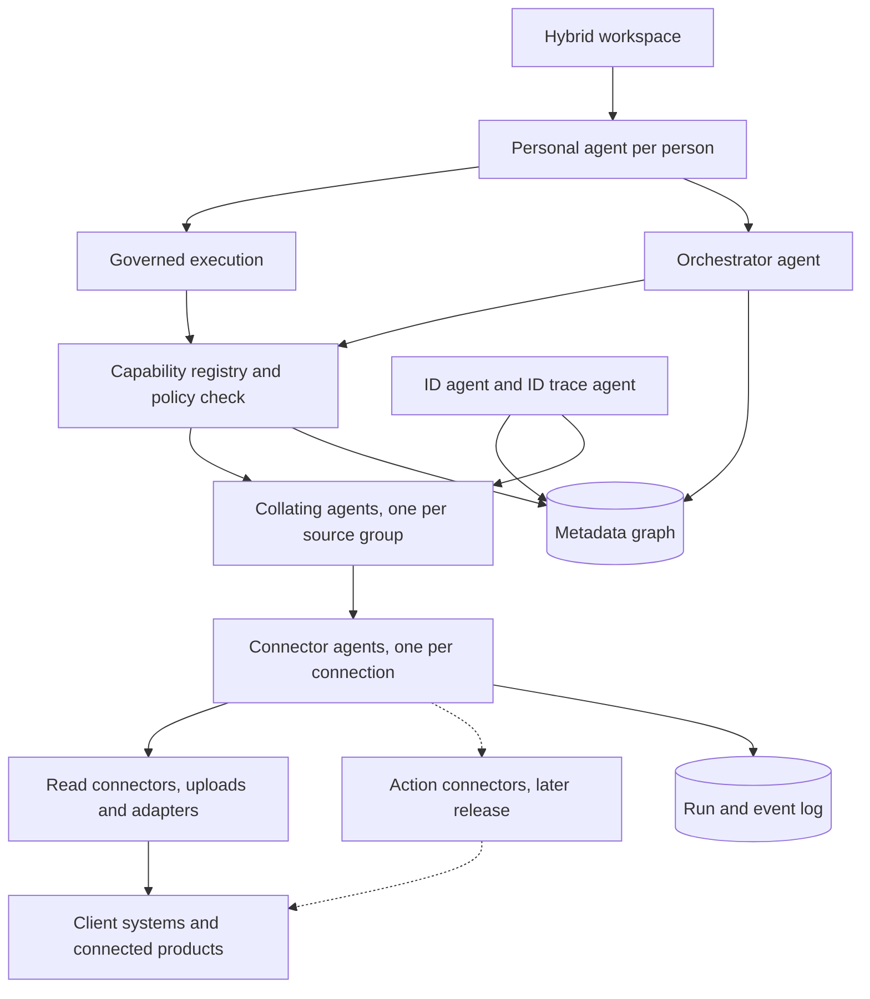

# Scale Insyght System Design v3.2

Nov 18, 2026 · @yashaswi ram

Scale Insyght is a standalone platform for enterprise data intelligence and governed agentic automation, built around one metadata graph of every connected system. This document defines the complete product, the subset built first as Release 1, and the eight foundational contracts to freeze before development starts.

Status: v3.2, updated with the manager's product explanation. Proposed for approval. Nothing described here has been built, and no repository, service or code has been created or changed.

## How to read this document

The document has three parts. Part 1 is everything Scale Insyght is designed to become. Part 2 is the subset built first. Part 3 is the set of contracts every module must obey, with the tests that prove it.

Every capability carries one of four status labels.

| Label | Meaning |
| --- | --- |
| Existing | Works in INSYGHT today and was verified in its code; carried over with typing and tests only |
| Reusable | Exists in INSYGHT but needs refactoring before it fits this design |
| Release 1 | New development, built in Release 1 |
| Later | Designed here, built after Release 1 |

"INSYGHT" always means the existing product in `RandomX707/INSYGHT`. It stays untouched: Scale Insyght has its own repository, database, deployment and configuration, and code is copied across, never shared.

### What changed from v2

- The scope is split into the complete product and Release 1, so phasing no longer shrinks the product.
- The hybrid workspace and the governed automation runtime are now specified, not only named.
- Lineage separates structural relationships from data flow, and human acceptance from independent verification.
- Cross-source computation has explicit classification, movement and disclosure rules.
- Governed agents move to phase 2, and the workspace shell starts in phase 1.
- Three statements about INSYGHT were wrong in v2 and are corrected in the reuse table: where feature flags are enforced, which drivers expose SQL validation, and how general the tool-result sanitiser is.

### What changed in v3.1

The product architecture and Release 1 scope are unchanged. Six contracts were hardened after review.

- **Contract 5:** fencing tokens on every claim, so a worker that outlives its lease cannot commit. External effects are no longer described as exactly-once. Retries of a finished run create a child run. A minimum event vocabulary and the legal state transitions are listed.
- **Contract 1:** how the tenant reaches the database, how pooling is handled and which database roles are forbidden, with five mandatory phase 0 tests.
- **Contract 7:** metadata is split into three classes with a scrubber and statistical limits. There is no default disclosure threshold; tagged data fails closed.
- **Contract 6:** verification needs a run event that names the specific flow at the same granularity. Reconciliation is recorded separately.
- **Contract 8:** grant consumption is atomic, and hand-off delivery is idempotent with reconciliation after an uncertain response.
- **Contract 4:** evidence is required for material claims, and interpretation is labelled.
- **Additions:** a traceability table from portfolio promises to components, phases and tests in 1.11, and a Mermaid version of the architecture diagram for exports.

### What changed in v3.2

The product explanation agreed with the manager on 18 November 2026 is folded in. The run model, approvals, tenancy, lineage evidence and the Release 2 automation boundary are unchanged.

- **Two modes:** the product is described as profiler mode, which runs by itself, and analytic mode, which answers questions.
- **Agent tiers:** collating agents are now lasting agents, one per group of related sources, between the orchestrator and the connector agents. A connector agent is created, and shown, when a connection succeeds.
- **ID agent and ID trace agent:** new agents that find identifier fields and trace how they travel, with an ID registry and ID paths in the graph.
- **Personal agents:** a headline feature, built from phase 2. They learn from remembered preferences; no model is trained on anyone's data.
- **Release 1 connectors:** SQL Server, PostgreSQL, Excel (uploaded), Snowflake, dbt, Tableau and Power BI. Oracle, Db2 and SAP follow on demand.
- **Uploaded files:** Excel workbooks are the only client data Scale Insyght stores, under a new storage rule in contract 7.
- **ER diagrams, nightly refresh, BI links and usage counting** are named features with phases and tests.
- **Contracts changed:** 1 (usage), 2 (agent types and groups), 3 (routing through collating agents), 6 (identifiers) and 7 (uploaded files, ID values). Contracts 4, 5 and 8 are unchanged.
- **Journey additions:** choosing what to include at connection, a notification on open after discovery and each nightly run (including changes that affect a report or saved question), and right-or-wrong feedback on every answer.

## Part 1: Complete product architecture

### 1.1 Product definition and boundaries

Scale Insyght lets a person connect one or many systems, ask how their data is structured and related, inspect evidence-backed lineage, get governed answers across sources, design data flows, and run reviewed operations through governed workflows. The same investigation is available as a conversation and as a visual workspace. It works alone, and it becomes the coordinated front door to Scale Data Hub when those products are connected.

It has two capability families, designed together and released in order.

- **Intelligence:** discovery, profiling, lineage, cross-source answers, governed analyses, reports and flow design. Everything here is read-only towards client systems.
- **Governed automation:** approved operations that change something outside Insyght, such as deploying a pipeline, retrying a job or writing a record. Every such operation is typed, approved and audited.

To the people who use it, Insyght works in two modes.

|  | Profiler mode | Analytic mode |
| --- | --- | --- |
| Runs | After every successful connection, every night for new and changed tables, and on request | Whenever someone asks a question |
| Does | Reads each source's structure, builds ER diagrams, profiles tables, maps probable lineage, groups related sources, finds every ID and traces how IDs travel | The personal agent puts the question in the person's terms; the cluster writes SQL for each source, runs it and combines the results |
| Produces | The metadata graph, ER diagrams, the ID registry and ID paths, collating groups, BI report links | One answer, shaped for the person, with its SQL, sources and lineage |

Profiler mode is how the platform is autonomous: no one has to ask for it. Analytic mode is autonomous in planning and execution, and read-only.

**What it is not**

- It is not a data warehouse and keeps no persistent copy of client business data, apart from files a customer chooses to upload, such as Excel workbooks. Temporary, authorised computation over result sets is allowed under the rules in contract 7.
- It does not replace specialised products. It coordinates pipeline, lake, standardisation, semantic and BI tools, and never forges their approvals.
- It cannot promise complete historical lineage where code, logs or mappings are missing. Unknown hops stay visible as gaps.
- A language model never executes SQL, shell, network or mutation operations directly. It proposes; typed capabilities execute.
- It does not fine-tune a model on any person's or client's data.

**Industry and cloud neutrality**

No industry, vendor or cloud shapes the core. Five rules enforce this.

1. Core contracts name no industry, vendor or cloud. A contract that needs a healthcare term or a vendor name is wrong.
2. Domain knowledge lives in semantic profile packs, which are data, not code paths. A clinical pack and a payer pack are two examples; a retail or banking pack is added the same way.
3. Vendor behaviour lives only inside connector drivers and Hub adapters.
4. Sensitivity classes and disclosure thresholds are tenant policy, not constants.
5. The platform runs as containers on any cloud or on-premise host. Its only required store is PostgreSQL; the model is any OpenAI-compatible endpoint, hosted or local.

Healthcare cohort analytics, CRM questions and legacy-to-cloud migration discovery are reference use cases. They supply test data and demonstrations, and nothing else.

### 1.2 Architecture at a glance

&#91;embedded content: Scale Insyght complete product · later-release parts dashed\]

A question enters through the workspace and travels down to the client's systems. Two stores on the right hold all shared truth: the graph says what exists and how it relates, and the run log says what was planned, done, decided and approved. Every workspace view reads those two stores, which is why the views cannot disagree.

The same structure in Mermaid, for exports that cannot carry the drawing:



### 1.3 Capability map

Of 36 capabilities, 3 exist in INSYGHT ready to carry over, 12 are reusable after refactoring, 17 are new in Release 1 and 4 come later. The basis column records what was found in the INSYGHT code.

| Capability | Status | Basis |
| --- | --- | --- |
| PostgreSQL and Snowflake read connectors | Reusable | Governed read, discovery and connection test for both; they expose SQL validation differently |
| Read-only SQL guard | Existing | Parser-based guard shared by both drivers |
| Credential encryption | Existing | AES-256-GCM |
| Governed agents: immutable versions, approval, model-free runs | Reusable | Works for one source and one profile per agent |
| Semantic profile packs | Reusable | Registry with content hashing, but the pack schema requires clinical fields; a clinical pack on `main`, a payer pack on `feat/payer-agents` |
| Versioned report schema with adapters and export | Existing | Excel and PowerPoint libraries present; PDF export not verified |
| Account tenancy | Reusable | Account is checked on every connection access; there is no database row-level security |
| Server-side entitlements | Reusable | Six flags are enforced on server routes; the rest are unaudited |
| Connector driver contract | Reusable | A driver map exists; SQL validation is exposed differently by the two drivers |
| Lake-engine and CRM read access | Reusable | Present as separate legacy routes and a CRM module, outside the driver map |
| Metadata harvest | Reusable | Discovery works; it writes a flat cache and deletes missing objects, losing history |
| Profiling | Reusable | Profiler exists; its date handling is written for one SQL dialect |
| Source agent | Reusable | A single-source chat turn exists; it is not callable by an orchestrator |
| Disclosure control | Reusable | Primary suppression plus one complementary cell, on one table at a time |
| Model gateway and model boundary | Reusable | One endpoint from environment settings and a fixed allow-list; the result sanitiser covers clinical tools only |
| Metadata graph | Release 1 | Nothing comparable in the core app |
| Lineage assertions, gaps and review | Release 1 | The only lineage view is a pipeline-stage list in the migrator |
| Offline metadata import | Release 1 | New |
| SQL Server, Excel upload, dbt, Tableau and Power BI connectors | Release 1 | New on the shared contract. Excel is uploaded; dbt and the BI tools are metadata connectors |
| Orchestrator, typed plan, collator, critic | Release 1 | New |
| Durable runs with recovery | Release 1 | Today a chat turn lives inside one open HTTP response |
| Capability registry and per-call authorisation | Release 1 | New; extends the agent tool allow-list idea |
| Hybrid workspace | Release 1 | Chat interaction patterns are reusable; the workspace is new |
| Personal agents | Release 1 | New |
| Hub adapters and FlowSpec hand-off | Release 1 | New |
| Plan-bound approval protocol | Release 1 | New; agent approval in INSYGHT is the starting pattern |
| Customer-side gateway | Release 1 | New |
| Run traces, audit and evaluation suite | Release 1 | An agent evaluation script exists on `feat/payer-agents` |
| Action connectors and operational workflows | Later | Designed in 1.7 and contract 8 |
| Workflow Studio and action approval inbox | Later | Designed in 1.4 |
| External workflow or policy engines | Later | Only on a demonstrated need |
| Collating agents per source group | Release 1 | New; groups proposed by the profiler and adjustable by the customer |
| ID agent, ID trace agent, ID registry and paths | Release 1 | New |
| ER diagrams with probable relationships | Release 1 | New view on the graph |
| Usage counting of users and connectors | Release 1 | New; pricing is per user and per connector |
| Oracle, Db2 and SAP connectors | Later | On customer demand, on the shared contract |

### 1.4 Hybrid workspace

The workspace is conversation-first with a persistent visual side. Every view is a different projection of the same investigation, never a separate application.

| View | What it shows | Status |
| --- | --- | --- |
| Conversation | Questions, answers with trust badges, citations, run status, and right-or-wrong feedback with corrections on each answer | Release 1, phase 1 |
| Source explorer | Connectors with their agents and an "agent created" status, schemas, ER diagrams, profiles, data dictionary, scan coverage, what changed overnight | Release 1, phase 1 |
| Agent workspace | The live plan as a graph, each agent's state, tool-call summaries, findings, conflicts | Release 1, phase 2 |
| Agent studio | Governed agents: definitions, versions, approvals, runs | Release 1, phase 2 |
| Lineage studio | Asset graph, evidence drawer, gaps, snapshot comparison, impact radius | Release 1, phase 3 |
| Review inbox | Lineage assertions, agent definitions and FlowSpecs awaiting a decision | Release 1, phases 2 to 4 |
| Reports | Evidence packs, governed reports, exports, and BI reports listed with links that open them in the BI tool | Release 1, phase 5 |
| Administration | Users, roles, policies, model routing, budgets, audit search, usage of users and connectors, collating groups | Release 1, grows per phase |
| Workflow studio | Operational workflow editor, simulation, action approvals, run history | Later |
| Notifications | What discovery found, what changed overnight, and any change that affects a BI report or a saved question. Waiting for the person when they next open Insyght, derived from run events | Release 1, phases 1 and 3 |

**The one-investigation contract**

1. An investigation is a named container of runs, pinned assets, notes and artifacts. It can be saved, reopened, shared and re-run.
2. Every answer, plan node, graph selection and report section carries the same run id, asset ids and artifact ids. Selecting an item in one view highlights it in the others and opens the same evidence drawer.
3. The browser holds no planning, security or workflow truth. Views render server state and subscribe to the run's event stream.
4. Conversation can change a draft. It cannot change an approved agent definition or an approved plan; that needs a new version and a new approval.
5. A link to a run is shareable, and permissions are rechecked each time it is opened.
6. Agent reasoning is shown as plan steps and tool summaries. Raw model output and unredacted results are never displayed.

The review inbox built in Release 1 is the same component that later carries action approvals, so the automation release adds a queue, not a new mechanism.

### 1.5 Agent ecosystem

An agent is a logical runtime: a prompt, a capability allow-list, a slice of the graph and the connections it may use. Agents have lasting identity and memory, but none is a standing process, so a hundred connections cost nothing while idle.

Agents are arranged in tiers. A personal agent sits in front of each person. One orchestrator serves each customer. Collating agents each look after a group of related sources, and one connector agent looks after each connection. Two ID agents work across all of them.

| Role | How many | Job | Uses a model for | Status |
| --- | --- | --- | --- | --- |
| Personal agent | One per person | Applies the person's remembered preferences to every question and answer; grants no access | Rewriting the question; shaping the answer | Release 1 |
| Orchestrator agent | One per customer | Finds the relevant assets in the graph, produces a typed plan, routes it through collating agents, assembles one answer | Producing the plan | Release 1 |
| Collating agent | One per group of related sources | Holds the group's cross-source relationships and join keys; joins its connector agents' results | Nothing for the join; it runs as SQL | Release 1 |
| Connector agent | One per connection, created when the connection succeeds | Knows its own source. Data connectors describe, profile and query in their own dialect; dbt and BI connectors read models, lineage and reports | Writing SQL for its source | Reusable |
| ID agent | One per customer | Finds identifier fields in every source and matches the same ID across sources | Proposing matches from names and formats | Release 1 |
| ID trace agent | Sub-agent of the ID agent | Follows each identifier through tables, systems, dbt models and reports | Nothing; it reads the graph | Release 1 |
| Critic | Part of each analytic run | Checks the result against the plan: missing steps, empty results, grain mismatches | Judging completeness | Release 1 |
| Governed agent | One per approved definition | Runs a saved, approved definition step by step | Nothing at run time | Reusable |
| Action executor | One per action connector | Executes an approved, compiled action plan with a separate identity | Nothing | Later |

**Collating groups.** The profiler proposes groups from the cross-source relationships and ID matches it finds, for example a group of operational databases and a group of warehouse and reporting tools. The customer can move a source between groups, split a group or merge two. A group is versioned, and a plan records which version it used. A source belongs to exactly one group.

**Agent created.** When a connection test succeeds, or a workbook is uploaded, its connector agent is registered in the same transaction that activates the connection, and the person sees that the agent was created. Profiler mode then starts for that source.

**What is not an agent.** Harvesting, profiling, ER inference, lineage collection, impact analysis and report composition are capabilities: registered functions that plan steps and profiler jobs call. A role becomes an agent only where it has its own memory, parallel fan-out or a reflection loop.

**How one question runs**

1. **Resolve.** The personal agent rewrites the question with the person's vocabulary, default sources and role.
2. **Locate.** The orchestrator searches the graph for the assets, metrics and reports the question touches.
3. **Plan.** The orchestrator emits a typed plan that routes each step through the collating agent for that source's group. A plan that fails validation is never run.
4. **Fan out.** Connector agents run their steps in parallel, read-only, each in its own dialect.
5. **Collate.** Each collating agent joins its sources' results in the isolated computation worker, using the ID registry for join keys. If the question spans groups, the orchestrator joins the groups' results the same way. The model never does arithmetic.
6. **Check.** The critic can trigger one bounded re-plan.
7. **Answer.** The personal agent shapes the answer for the person. It carries a trust badge, the lineage of each number and the queries behind it.

**Trust order.** An answer uses the most governed route available and says which one: a certified metric from a connected semantic layer, then an approved operation from a semantic profile pack, then a glossary definition applied to guarded SQL, then guarded exploratory SQL.

**Personal agents.** A personal agent learns from remembered preferences. It is retrieval and memory, not model training: nothing about a person is used to train or fine-tune a model.

| It remembers | Example | Effect |
| --- | --- | --- |
| Role | Business lead, engineer, researcher | Answers lead with a summary, the SQL or the lineage |
| Vocabulary | "Revenue" means net revenue | Applied before planning |
| Default sources | "I always mean the Snowflake sales schema" | Orders which sources are tried first |
| Saved questions | A question and the plan that answered it | Reused as a starting plan; saved only after the person accepts the answer |
| Answer style | Chart or table, headline or full detail | Applied when the answer is shaped |
| Corrections | A term or default fixed once | Remembered for next time |

It stores definitions, plans and preferences, never result rows. It belongs to one person in one tenant, and that person can read, edit or delete all of it. It shapes answers and never widens access.

**Feedback.** Every answer can be marked right or wrong and corrected. Feedback is stored as the question, the plan, the SQL and the verdict, never the result rows. A correction updates only that person's memory, and every answer marked wrong joins the tenant's evaluation set, which is how answer quality is measured release to release.

### 1.6 Metadata graph and lineage

The graph records what exists in every connected system and how those things relate. It holds metadata, statistics and evidence, and no business rows.

**Assets.** System, container (database, schema, layer), dataset (table, view, file, object, topic), field, process (pipeline, task, model, job, procedure, query), metric, business term, report and tile, release, owner. A field that holds an identifier is marked as one, with its format and the entity it identifies. Each asset has a tenant-scoped stable id, a qualified name, a fingerprint, a sensitivity class and a version history. A removed asset is marked inactive, never deleted.

**Relationships** fall into five families, and only one of them is lineage.

| Family | Relationships | What it says |
| --- | --- | --- |
| Structural | `CONTAINS`, `REFERENCES`, `SAME_AS` | How things are arranged and keyed. A foreign key is `REFERENCES` |
| Data flow | `READS`, `WRITES`, `DERIVES_FROM`, `MAPS_TO` | Data moved from one thing to another. This is lineage |
| Semantic | `MEASURES`, `DEFINES`, `DISPLAYS` | A metric is computed from fields; a report shows a metric |
| Responsibility | `OWNS`, `USES` | Who is accountable for an asset and who queries it |
| Succession | `REPLACES` | One asset supersedes another |

A structural relationship can support an inferred flow as evidence. It is never drawn as a flow.

**Three separate facts about every data-flow assertion**

| Fact | Values | Set by |
| --- | --- | --- |
| Evidence method | Observed, declared, parsed, inferred | The collector that produced it |
| Review status | Unreviewed, accepted, disputed, rejected, stale | A reviewer, or a change in the evidence |
| Verification | Unverified, run-verified, reconciled | An independent check only |

- **Observed** means a run that actually executed reported it. **Declared** means a manifest, pipeline definition or mapping file states it. **Parsed** means it was extracted from code or query text. **Inferred** means it was proposed from names, types, value profiles, documents or a model.
- **Accepted** records a person's judgement that an assertion is plausible. It does not make the assertion verified, and the interface never shows it as verified.
- **Run-verified** is set only when an event from a successful run names this specific input and output, at the same granularity. An event from the same job that does not name the pair verifies nothing, and a dataset-level event cannot verify a field-level flow.
- **Reconciled** means a test comparing source and target values passed. It shows the two are consistent, not that the data travelled by this path, so it is displayed differently from run-verified.
- An accepted inference with neither check stays "accepted, unverified" permanently.

**Gaps.** Where a hop cannot be inspected, the graph stores a gap record and draws a broken link. Every lineage answer reports its coverage: the share of the path that is observed, declared, parsed, inferred and missing.

**Time.** Each assertion carries when it was captured and the period it is known to have held. A query for a past date returns what had been captured by that date. For dates before the first capture, it returns only assertions whose evidence carries its own date, such as version-controlled code, logs or dated documents, and marks everything else "not observable at that date". Capturing metadata today never reconstructs the past.

**Keeping it current.** On connect, harvest, profile, infer the ER diagram, collect declared and parsed flows, find identifiers, and propose inferred flows, `SAME_AS` candidates and collating groups. Every night, check every connector for new and changed tables and schemas, repeat those steps for what changed only, and record each difference as a graph event the person can see.

**ER diagrams.** Each data source gets an ER diagram built from its information schema. Declared keys are drawn solid. Relationships the profiler infers from names, types and value overlap are drawn as probable, with their evidence, until a person accepts them. For an uploaded workbook, each sheet is a table and relationships are always inferred.

**Identifiers.** The ID agent keeps an ID registry: every identifier field, its format, the entity it identifies, and `SAME_AS` matches between identifier fields in different sources. The ID trace agent derives ID paths: the chain of data-flow assertions an identifier follows through tables, systems, dbt models and reports, noting where it is renamed, reformatted, combined or dropped, and how well its values overlap between two systems. ID matches and paths carry the same evidence, review and verification facts as any other assertion. ID values themselves are handled under contract 7.

**Scope.** When connecting, the customer chooses which databases, schemas and tables to include. Everything the connection can see is offered, with system schemas excluded by default. Objects left out are recorded by name and type only, so the customer can see what was excluded, and are never profiled, sampled, fingerprinted or queried. Scope can be changed later, and the next nightly run picks up the change.

**Storage.** PostgreSQL tables behind a graph repository interface. A dedicated graph engine is considered only if a benchmark on a realistic graph misses the traversal target set in decision 9.

### 1.7 Execution model: intelligence and governed automation

Everything an agent can do is a registered capability with an effect class. The effect class decides whether it may run autonomously, and it is the single switch that separates Release 1 from later releases.

| Effect class | Example | Control | Status |
| --- | --- | --- | --- |
| `METADATA_READ` | List schemas, read a view definition | Allowed within the person's source scope | Release 1 |
| `AGGREGATE_READ` | Guarded SQL, certified metric lookup | Policy and disclosure checks | Release 1 |
| `EXPORT` | Download a report or data dictionary | Export policy and audit | Release 1 |
| `CREATE_DRAFT` | Draft a FlowSpec, a governed agent, a mapping | Allowed; a draft changes nothing outside Insyght | Release 1 |
| `HANDOFF` | Send an approved FlowSpec to a pipeline product | Plan-bound approval; the receiving product keeps authority | Release 1 |
| `MUTATION` | Write a record to a source system | Plan-bound approval, action identity | Later |
| `DEPLOY`, `RELEASE` | Deploy a pipeline, publish a release, retry a job | Plan-bound approval, simulation, verification | Later |
| `IRREVERSIBLE` | Drop a schema, cut over a migration, change access | Multi-party approval, off by default | Later |

**Two execution paths share one runtime.**

- **Investigation.** The orchestrator plans autonomously, using only the first four classes. This is where the platform is autonomous.
- **Governed execution.** A definition is compiled, approved and then run step by step with no model call. Governed read-only agents use this path in Release 1. Operational workflows use the same path later, with action connectors and stricter approvals.

Profiler mode runs as scheduled and event-triggered jobs on the same runtime: on connection, nightly, and on request. Analytic mode is the investigation path. Both get the durability guarantees of contract 5.

**Workflow definition (Later; shape fixed now).** A versioned document holding inputs, nodes that reference capabilities, edges with typed conditions over step outputs, approvals, schedule, timeout, retry, idempotency and compensation rules. It is compiled to runner steps. Model-generated code is never executed.

**Action lifecycle (Later).** `DRAFT → SIMULATED → POLICY_REVIEW → AWAITING_APPROVAL → APPROVED → EXECUTING → VERIFIED → CLOSED`

- A policy denial stops the step before any tool runs. There is no automatic workaround.
- The intent of an external effect is recorded before the call. If the outcome is uncertain, the step waits as outcome unknown and is never retried blindly.
- What happens next depends on the target. If it deduplicates on a key, a retry is safe. If it can report an outcome, it is asked first. If it can do neither, the effect is at-most-once and a person resolves it. Insyght does not claim exactly-once effects.
- A failure after a partial effect records the exact partial state, runs compensation if one is defined, and otherwise waits for a person.
- An expired approval discards the executable grant.
- Success is reported only after the target system confirms the resulting state.

**Scheduling.** Scheduled runs of governed read-only agents are Release 1. Scheduled actions are Later.

**Runner.** The runtime is built on PostgreSQL in Release 1. Its guarantees come from leases, atomic step claims, idempotency keys and transactional event writes, defined in contract 5. The runner sits behind an interface so a workflow engine can replace it if decision 7's criteria are met.

### 1.8 Integration strategy

**Source connectors.** Every source type implements one read contract: capabilities, test, discover, profile, collect lineage evidence, validate a query, run a governed read. Action connectors are a separate interface with separate credentials, so no analytical path can hold a credential that changes a source.

**Four ways to reach a source.**

| Pattern | Used when | Status |
| --- | --- | --- |
| Direct read-only account | The source is reachable from the deployment | Release 1 |
| Customer-side gateway | The source is in a private network; the gateway holds credentials and dials out, so no inbound port is opened | Release 1 |
| Uploaded file | The customer uploads a workbook. It is stored encrypted for that tenant, and each sheet is queried as a table in the isolated computation worker | Release 1 |
| Offline metadata import | The source cannot be connected: schema files, data dictionaries, mapping documents, code archives | Release 1 |

**Tool connectors.** dbt, Tableau and Power BI connect like any source and each gets a connector agent. Their agents read metadata rather than data: dbt supplies models, tests and declared lineage between tables; the BI tools supply reports, dashboards and the datasets behind them. That turns parts of the probable lineage into declared lineage, from source table to dashboard. Reports are listed with links that open them in the BI tool.

**Platform adapters.** Each connected product gets a versioned adapter. The same adapter contract serves Scale Data Hub products and third-party pipeline, semantic or BI tools.

| Product | Insyght reads | Insyght proposes | Authority stays with |
| --- | --- | --- | --- |
| Scale Data Studio | Pipelines, runs, mappings, validation scores, pipeline lineage | A FlowSpec, after approval | Data Studio |
| Scale Data Lake | Environments, catalogue, layers, tables | Nothing in Release 1 | Data Lake |
| Scale Weave | Releases, quality-gate results, source-to-standard mappings | Nothing in Release 1 | Weave |
| Scale Semantics | Certified metrics, dimensions, compiled queries | A governed metric request | Semantics |
| Scale BI and BI tools | Report inventory, dependencies, report links that open in the tool | Nothing in Release 1 | The BI tool |

Insyght never reports another product's operation as successful until that product returns the confirmed state. The platform stays fully usable with no adapter connected.

### 1.9 Security principles

1. Authorisation is checked at the API and again at every capability call, for the person, the connection and the purpose.
2. Prompts are not security controls. Text retrieved from sources, documents and tools is untrusted data and cannot change scope or permissions.
3. Tenant isolation is enforced in the database with row-level security, and proven by negative tests.
4. The model receives metadata and policy-cleared aggregates. It never receives credentials, direct identifiers or restricted rows.
5. Analytical credentials are read-only. Action credentials are separate, least-privilege and used only by the action executor.
6. Every approval is bound to an exact plan, snapshot, approver and expiry.
7. Every run, policy decision and tool call is recorded in an append-only log.
8. Secrets are stored by reference to a secrets backend, encrypted at rest, and never written to logs, prompts or the graph.
9. Uploaded files are the only client data stored. They are encrypted, kept per tenant and removed with their connector. Identifier values are restricted: the platform keeps salted fingerprints of them for matching, never the values.

### 1.10 Extensibility

Six interfaces are replaceable. Each starts with the simplest implementation and names the condition for changing it.

| Interface | Release 1 implementation | Possible replacement | Replace when |
| --- | --- | --- | --- |
| Graph repository | PostgreSQL tables and recursive queries | A graph engine | The traversal benchmark is missed |
| Run engine | PostgreSQL-backed runner | A workflow engine | Decision 7's criteria are met |
| Policy decision | In-process policy function | An external policy engine | Tenants need to author their own policies |
| Model gateway | One OpenAI-compatible client | Per-tenant routing across providers | A tenant requires a local or dedicated model |
| Artifact store | PostgreSQL large objects or a mounted volume | S3-compatible object storage | Evidence bundles outgrow the database |
| Search | PostgreSQL full-text search | A vector index | Asset search quality is measured as inadequate |

New source types arrive through the connector contract, new domains through semantic profile packs, and new products through platform adapters. None of the three changes the core.

### 1.11 Traceability to the portfolio

Each promise the portfolio makes for Scale Insyght maps to a component, the phase that delivers it and the test that proves it. Eighteen are delivered in Release 1 and one moves to Release 2.

| Portfolio promise | Component | Phase | Proving test |
| --- | --- | --- | --- |
| Connect a source and understand it within minutes | Read connectors, harvest, profiling | 1 | A 500-table schema is browsable in 10 minutes with zero model calls |
| Connectors from legacy and on-premise to cloud, lake and applications | Connector contract, gateway, offline import | 1, 3, 6 | Per-connector contract suite; gateway works with no inbound port |
| One agent per source and per Hub platform | Source agents, platform agents | 2, 4 | Two-source answer; suites pass with adapters disconnected |
| An orchestrating agent plans and routes each question | Orchestrator, contract 3 | 2 | Every invalid plan is rejected; no step runs outside its plan |
| A collating agent combines answers from many systems | Collator, contract 7 | 2 | Both queries and the join are shown; post-join suppression holds |
| Agents read metadata rather than copying data | Metadata graph, temporary computation rule | 1, 2 | No intermediate result survives a run; no rows in model requests |
| Metadata profiling with a data-quality report and data dictionary | Profiler, source explorer | 1 | Two profiling runs match; dictionary exports |
| End-to-end lineage from source system to semantic layer | Assertions, gaps, contract 6 | 3, 4 | Golden dataset reproduced; the missing hop stays a gap |
| Data-flow design handed to Scale Data Studio | FlowSpec, `HANDOFF`, contract 8 | 4 | Blocked without a grant; delivered exactly once after a dropped response |
| Natural-language questions answered as tables and charts, read-only | Source agent, SQL guard, trust order | 2 | 90% of the golden set; guard-bypass suite passes |
| Semantic layer invoked directly | Semantics adapter, first trust route | 4 | The metric equals the semantic layer's own value |
| Reports from BI tools opened in the browser; dashboards exported | BI adapter, reports | 4, 5 | Report opens with the viewer's permissions; exports reproduce the run's figures |
| Personal agents that learn each person's use cases | Personal agent | 2, 5 | Same numbers in a different shape; zero result rows in memory |
| Governed agents: validated, immutable, approved, authorised per step, small cells suppressed | Governed execution, contracts 2 and 7 | 2 | Identical re-run; a refined agent needs re-approval |
| The model proposes and never executes; credentials and person-level rows never reach it | Contract 3 rule 1, contract 7 | 0, 1 | Model-boundary scans, including the metadata tests |
| Pluggable model endpoint with allow-lists, input limits and injection handling | Model gateway | 0, 6 | Adversarial suite passes in full |
| Account-scoped multi-tenancy with server-side authorisation | Contract 1 | 0 | The five mandatory tenant-isolation tests |
| Cloud, private-network and hybrid deployment | Containers, customer-side gateway | 0, 6 | Reference deployment starts cold; gateway test |
| Writes to systems of record behind a confirmation, with field-level audit | Action connectors, contract 8 | Release 2 | In Release 1, a plan with a write step ends as `POLICY_BLOCKED` |

Two portfolio details are not carried as written. PDF export was not found in the INSYGHT code and is listed as new work in phase 5. Account summary cards for one CRM are treated as a profile-pack feature, not a core capability.

**Promises added by the product explanation (v3.2)**

| Promise | Component | Phase | Proving test |
| --- | --- | --- | --- |
| Two modes: profiler runs by itself, analytic answers questions | Profiler jobs, investigation path | 1, 2 | A new connection is profiled with no one asking; a question is answered from the profile |
| An agent is created and shown after every successful connection | Contract 2, agent registry | 1 | Activating a connection and registering its agent happen together or not at all |
| An ER diagram from each information schema | Graph, ER inference | 1 | Declared keys solid, inferred relationships marked probable |
| Nightly run for new tables and schema changes | Profiler schedule | 1 | An unchanged table is not re-profiled; a new one is, and the change is shown |
| Collating agents stitch related sources; one orchestrator over them | Contracts 2 and 3 | 2 | A two-group question routes through both collating agents and is joined once |
| Agents personal to each user, learning from remembered preferences | Personal agent | 2, 5 | Two people get the same numbers in different shapes; memory holds no result rows |
| ID agent finds IDs; sub ID agent tracks how they travel | ID agents, contract 6 | 3 | Golden dataset: renamed customer ID traced across three systems; no raw ID value stored |
| dbt, Tableau and Power BI connectors; reports open by link | Tool connectors | 3 | Report list matches the BI tool; dbt lineage recorded as declared |
| Excel workbooks as a source | Uploaded file connector, contract 7 | 1 | Sheets queryable; file encrypted, tenant-scoped, removed with its connector |
| Priced by users and connectors | Usage counting, contract 1 | 0 | Counts per tenant match the activity log |
| Choose what to include at connection | Scope step, contracts 3 and 6 | 1 | Out-of-scope objects get zero profiling and query statements |
| Notification on open after discovery and nightly runs | Notifications view, run events | 1, 3 | One summary shown once on open; a dropped column used by a report is named |
| Mark answers right or wrong, and correct them | Feedback, personal agent, evaluation set | 2 | A correction changes only that person's next answer and joins the evaluation set |

## Part 2: Release 1 architecture

### 2.1 Scope

Release 1 delivers enterprise data intelligence. It reads, explains and proposes; it changes nothing in a client system.

| In Release 1 | Designed in Part 1, built later |
| --- | --- |
| Multi-source connection, metadata discovery, profiling, ER diagrams, nightly refresh, the metadata graph | `MUTATION`, `DEPLOY`, `RELEASE` and `IRREVERSIBLE` capabilities |
| Multi-agent answers across sources on durable runs | Action connectors and write-back to any source |
| Cross-system lineage with evidence, review, verification and gaps | Operational workflow definitions and their compiler |
| Governed analytical execution: governed agents, certified metrics, disclosure control | Workflow Studio and action approvals |
| Scale Data Hub adapters and approved FlowSpec hand-off | Scheduled actions |
| The hybrid workspace, from a shell in phase 1 |  |
| Personal agents, reports and exports |  |

Five things are built in Release 1 specifically so automation needs no redesign: effect classes exist for every action type and are switched off; the plan schema already carries approval and compensation fields; the runner already enforces idempotency keys; the review inbox already handles plan-bound approvals; and the connector contract already defines the action interface, with no implementation behind it.

v3.2 adds to Release 1: collating agents per source group, the ID agent and ID trace agent, personal agents from phase 2, uploaded Excel workbooks, dbt, Tableau and Power BI connectors with report links, and usage counting for pricing. Release 1 data connectors are SQL Server, PostgreSQL, Excel and Snowflake.

### 2.2 Separation from INSYGHT

- Scale Insyght has its own repository, database, deployment, configuration, domains and secrets.
- No table, service, credential or process is shared with INSYGHT, and INSYGHT is only ever read.
- Code is copied, not linked. Each copied module records its source path and commit, and arrives with its tests.
- The INSYGHT backend is JavaScript. Copied modules gain types as they are copied, so "carried over" always includes that step.

### 2.3 Stack and deployment

| Component | Choice | Note |
| --- | --- | --- |
| Web workspace | React, TypeScript, Vite | React Flow for the plan canvas; D3 where lineage layout needs it |
| API and agent runtime | Node.js with TypeScript, one modular application | Not split into services |
| Workers | Same codebase, separate processes by job type | Discovery, lineage, investigation, reports |
| Operational store, graph, run events, job queue | PostgreSQL with row-level security | One database, several schemas |
| Cross-source computation | DuckDB in an isolated worker, in memory only | Nothing is persisted; governed by contract 7 |
| SQL lineage parsing | A small Python service using SQLGlot | Behind a typed interface |
| Model access | One OpenAI-compatible gateway | Hosted or local model by configuration |
| Private connectivity | Customer-side gateway container | Outbound connection only |
| Packaging | Containers, with a Compose reference deployment | An orchestration platform only where a client requires it |

Release 1 adds no workflow engine, policy engine, graph database, vector database, message broker or cache server. Each has a named trigger in 1.10. Uploaded workbooks go through the artifact store interface, encrypted per tenant, and are read into the isolated computation worker for queries.

### 2.4 Reuse from INSYGHT, verified against the code

Each row was checked by reading the code on `main` at commit `56669ee` and on `feat/payer-agents` at commit `53eec8b`. Of 22 module groups, 4 can be reused as they are, 13 need refactoring, 4 are replaced by new development and 1 is not used.

| Module in INSYGHT | Branch | Behaviour found in the code | Class |
| --- | --- | --- | --- |
| `agents/sqlGuard.js` | main | Parser-based read-only guard, called by both connectors | Reuse |
| `utils/crypto.js` | main | AES-256-GCM, with an older CBC path kept for reading legacy values | Reuse, without the legacy path |
| `services/connectionAccess.js` | main | Rejects a connection whose account differs from the user's | Reuse, under row-level security |
| `reports/` schema, repository, service, export | main | Versioned report schema, adapter registry, Excel and PowerPoint export | Reuse |
| `connectors/` driver map, PostgreSQL, Snowflake | main | Prepare, test, discover, governed read. Snowflake exposes `validateSql` and profiling; PostgreSQL validates inside its read call | Refactor: one validation interface, plus capabilities and lineage methods |
| `agents/definitionSchema`, `agentRepository`, `agentApproval`, `agentRuntime` | main | Strict schema, immutable versions, approval, sequential model-free run with an idempotency key and per-step re-authorisation; one connection and one profile per agent | Refactor: run on the durable runner, allow several sources |
| `agents/agentBuilder`, `agentRequestPlan` | main, payer | A model drafts a definition that must pass the schema; the branch adds request planning | Refactor |
| `semantic/profileRegistry`, `profiles/` | main, payer | Validated, content-hashed profiles. The profile schema requires clinical fields such as cohorts and a data-model version | Refactor: a pack schema with no industry-specific fields |
| `reports/adapters/` | main, payer | One adapter per profile: clinical on `main`, payer on the branch | Refactor: adapters ship inside their pack |
| `semantic/disclosure.js` | main | Primary suppression with a default threshold of 5 and one complementary cell, for one table | Refactor: tenant threshold, multi-dimension, post-join |
| `utils/llm.js` | main | OpenAI-compatible client, a fixed model allow-list, one endpoint from environment variables | Refactor: per-tenant routing, budgets |
| `services/sourceProfiler.js` | main | Row counts, distinct values, date ranges and sample rows, masked by column-name pattern; date parsing is Snowflake-specific | Refactor: dialect-neutral, classification-based masking, samples off by default |
| `agents/dataSourceTurn`, `tools/queryData` | main | One-source SQL turn with schema-grounded prompts and retry | Refactor into the source agent's query capability |
| `services/metricGlossary`, `joinHints`, `queryGrain` | main | Per-connection glossary, join hints and grain detection | Refactor as inputs to the third trust route |
| `services/featureResolver`, `middleware/access` | main | Account and user overrides, a fail-closed strict variant, six flags enforced on server routes | Refactor into capability-level entitlements |
| `routes/chat`, `agents/sseEvents`, chat components | main | Conversations and streamed events, tied to one open HTTP response | Refactor onto the run event log |
| `scripts/agentEval.js` | payer | An agent evaluation script | Refactor into the evaluation suite |
| `agents/safeToolResult.js` | main | Removes fields by column-name pattern, and only for clinical tools | New: a classification-driven model boundary |
| `services/sourceSchema`, `metadataSync` | main | Schema cache in one flat table; missing objects are deleted | New: the graph; the discovery output shape is kept |
| `agents/router.js` | main | A 1,595-line router centred on one CRM, with pattern-based routing | New: orchestrator and plan |
| Pipeline lineage view in the migrator | main | A stage list read from one scheduler | New: lineage assertions |
| `services/goldenCache.js` | main | A demonstration-only exact-match cache for email extraction | Not used. v2 wrongly offered it as the pattern for saved skills |

The CRM read and write tools under `crm/` and `agents/tools/` are not in Release 1. Their read path becomes an ordinary connector in phase 6, and the write tools wait for the automation release.

This is a reading of the code. It is not a security audit, a licence review or a runtime test, and decision 13 covers that audit.

### 2.5 Phases

Release 1 has eight phases. Each ends with something a person can be shown and a set of pass-or-fail criteria. Phase 5b validates the approved synthetic baseline against local real PostgreSQL/dbt systems and an explicitly local OpenAI gateway run; it does not add vendor services or production credentials. The numeric thresholds are proposals for approval under decision 15, not measurements.

**Phase 0: Foundation and contracts.** New repository scaffold, tenancy with row-level security, authentication, capability and agent registry, the durable runner and event log, model gateway, policy function, usage counting, and a contract test suite in continuous integration.

- *Outcome:* a scripted two-step run that survives its worker being killed, shown for two isolated tenants.
- *Acceptance:* all tests for contracts 1, 2 and 5 pass, including the five mandatory tenant-isolation tests and the stale-worker, lost-response and child-run tests. A worker killed mid-run 20 times loses and duplicates zero steps. Usage counts per tenant match the activity log. INSYGHT shows no new commits and no new database connections.

**Phase 1: Profiler mode, ER diagrams and the workspace shell.** SQL Server, PostgreSQL and Snowflake connectors on the shared contract, and Excel upload. A connector agent created and shown for every connection, and a scope step to choose which databases, schemas and tables to include. Harvest, profiling, ER diagrams, the nightly refresh of new and changed tables, the source explorer, in-app notifications of what discovery and each nightly run found, and the conversation view answering catalogue questions without a model.

- *Outcome:* connect three databases and upload a workbook, see each agent created, browse ER diagrams and profiles, and the next morning see what changed overnight.
- *Acceptance:* a 500-table schema is harvested and browsable within 10 minutes with zero model calls. Two profiling runs on an unchanged source produce identical results. A nightly run issues zero profiling queries for unchanged tables and profiles every new or changed one. Activating a connection and registering its agent succeed or fail together. An uploaded workbook is encrypted, invisible to other tenants and gone after its connector is removed. The five metadata-boundary tests in contract 7 pass. Scan coverage is shown as a percentage, with inaccessible objects listed. An object left out of scope receives zero profiling and query statements. A person opening Insyght after discovery or a nightly run sees one notification summarising it, shown once.

**Phase 2: Analytic mode with collating, personal and governed agents.** Collating groups proposed by the profiler and adjustable by the customer, collating agents, orchestrator, plan validator, critic and trust badges. Personal agents with role, vocabulary, default sources, answer style and corrections. Right-or-wrong feedback on every answer, feeding the person's agent and the evaluation set. The governed-agent runtime carried onto the durable runner. The agent workspace, agent studio and review inbox.

- *Outcome:* one question spanning two source groups answered for two different people, each in their own shape, and a governed agent approved and re-run.
- *Acceptance:* the two-group question routes through both collating agents, and both queries and both joins are shown. The two people's answers match in every number and differ in shape. A scan of personal memory finds zero result rows and zero identifier values, and each person can view, edit and delete their memory. A personal agent cannot reach a source its person is not entitled to. A forced timeout on one source ends the run as `PARTIAL`. A page refresh mid-run resumes with zero duplicated events. A governed agent re-run returns identical numbers. At least 90% of a 30-question golden set per connector returns the expected result. Marking an answer wrong with a correction changes that person's next answer to the same question and no one else's, and adds the question to the evaluation set.

**Phase 3: Lineage, IDs and tool connectors.** dbt, Tableau and Power BI connectors with report links. Declared and parsed collectors, the SQL parser service, inferred matching, review and verification, gaps, offline metadata import. The ID agent and ID trace agent. The lineage studio, impact analysis and snapshot comparison. Notifications when a schema change affects a BI report or a saved question.

- *Outcome:* a Power BI number traced to its source column through Snowflake and dbt to SQL Server, with evidence on every hop and a visible gap, and a customer ID traced across three systems.
- *Acceptance:* on the golden dataset, 100% of dataset-level flows and at least 90% of the selected column-level flows are reproduced. The seeded missing hop appears as a gap with zero invented edges, and the seeded conflicting mapping appears as disputed. An accepted inference is never rendered as verified. A renamed customer ID is matched as probable and its path traced with the rename noted. A scan of the graph finds zero raw identifier values. The report list matches each BI tool, and dbt edges are recorded as declared. Dropping a column used by a Power BI report produces a notification naming that report. A depth-4 traversal on a 100,000-asset synthetic graph completes in under 5 seconds at the 95th percentile.

**Phase 4: Scale Data Hub integrations.** Adapters for Data Studio, Semantics and BI first, then Data Lake and Weave; the certified-metric route; FlowSpec draft, approval and hand-off.

- *Outcome:* a certified metric answered through the semantic layer and a FlowSpec approved and accepted by Data Studio.
- *Acceptance:* the certified metric equals the value the semantic layer returns directly. A hand-off without approval is blocked, and changing the mapping after approval invalidates it. Success is shown only after the receiving product confirms. With every adapter disconnected, the phase 1 to 3 suites still pass.

**Phase 5: Saved questions and reports.** Saved questions for personal agents, evidence packs and governed reports with Excel, PowerPoint and PDF export, and scheduled runs of governed agents.

**Phase 5b: Real connections.** Exercise the PostgreSQL connector against a local synthetic hospital database, import a locally generated dbt manifest, and optionally run analytic and lineage flows through the OpenAI-compatible gateway under the disclosure and per-tenant budget controls. Tableau and Power BI remain fixture-based. SQL Server and Snowflake remain unconfigured until their prerequisites are supplied.

- *Outcome:* a saved question reused as the starting plan for a similar one, and an evidence pack exported from a run.
- *Acceptance:* a question is saved only after its person accepts the answer. A similar question starts from the saved plan, and a person can delete a saved question. An exported pack reproduces the run's figures exactly.

**Phase 6: Enterprise connectivity, hardening and deployment packaging.** The customer-side gateway, lake-engine and CRM read connectors, Oracle, Db2 and SAP on demand, single sign-on, the evaluation suite, backup and restore, load and security testing. Dockerfiles and Compose are added for deployment only; local development and tests continue to use native processes.

- *Outcome:* a private-network source answered through the gateway, and a restore drill.
- *Acceptance:* the gateway works with no inbound port open. The adversarial suite passes in full: prompt injection in metadata, SQL guard bypass, cross-tenant access, request forgery. A restore drill loses at most 15 minutes of data and completes within 4 hours. The first progress event of a run arrives within 3 seconds at the 95th percentile.

Governance and the run model exist from phase 0, and the workspace gains one or more views in every phase. A production pilot that needs a private-network source cannot start before the gateway exists; decision 5 can pull the gateway forward to follow phase 1.

**Release 2: Governed automation (Later).** Action connectors, the workflow compiler, Workflow Studio, action approvals and scheduled actions, built on the contracts in Part 3.

### 2.6 First demonstration

The first external demonstration is the end of phase 3 on synthetic data, with no Hub product and no client data. It shows the seven connectors each with its agent created, ER diagrams, a question spanning two source groups answered differently for two people, a Power BI number traced back to SQL Server with one honest gap and one disputed mapping, and a customer ID followed across three systems.

## Part 3: Foundational contracts and acceptance tests

These eight contracts are frozen before development. Every module depends on them, so a change after sign-off needs a recorded decision. Each contract gives its shape, the rules that must always hold, and the tests that prove them. Field lists are normative; exact types and table layouts are written per phase.

### Contract 1: Identity, tenancy and authorisation

```
Principal      { tenant_id, principal_id, kind: user | service | run,
                 roles[], groups[], attributes{} }
AuthzRequest   { principal, capability_id, resources[], purpose, environment }
AuthzDecision  { decision_id, outcome: allow | deny | require_approval,
                 obligations[], policy_version, reasons[] }
```

An obligation is a condition attached to an allow, such as a row cap, a mask or a disclosure check.

**Rules**

1. Every tenant-owned table carries `tenant_id` and is protected by row-level security. The tenant comes from the authenticated session, never from a request body.
2. A run acts with the entitlements of the person who started it, and never with more.
3. An administrator role grants configuration rights. It does not grant access to data in connected sources.
4. Authorisation is evaluated at the API and again immediately before every capability call. Each decision is stored with its policy version.
5. Policy is evaluated behind one interface, so the engine can change without changing callers.

**How tenant identity reaches the database**

1. The API takes the tenant from the verified session and begins every database transaction by setting it as a transaction-local value. Row-level security policies read that value.
2. Because the value lasts only for the transaction, a pooled connection carries no tenant from one request to the next. A transaction with no tenant set sees zero rows and can write none.
3. The application and worker database roles do not own the tables, are not superusers and do not hold the privilege that bypasses row-level security. Tables force row-level security, so even the owning role is subject to it.
4. Schema migrations run under a separate role that the running application cannot use.
5. A job that must cross tenants, such as retention clean-up, uses a named privileged role from dedicated code, and each use is audited.
6. A worker takes the tenant from the stored run record. It never trusts a tenant supplied in a job payload.

**Usage counting**

```
UsageRecord { tenant_id, period, active_users,
              active_connectors{ by_type: { sql_server, postgres, snowflake,
                                            excel, dbt, tableau, power_bi, ... } },
              computed_from_event_ids_range }
```

1. Users and connectors are counted per tenant from the event log, never from a separately maintained number.
2. Connectors are counted by type, so pricing can treat data sources and tool connectors the same or differently without a schema change.
3. Adding a connector checks the tenant's connector allowance inside the same transaction that activates it.

**Acceptance tests**

- A query issued with tenant A's session returns zero rows of tenant B from every table, including through search and shared links.
- A transaction opened with no tenant set returns zero rows from every tenant-owned table and fails on insert.
- Over 1,000 interleaved requests for two tenants on a small connection pool, no response contains the other tenant's data.
- A check of the database catalogue in continuous integration confirms that the application and worker roles own no tables and cannot bypass row-level security, and that every tenant-owned table forces it.
- A job submitted with a forged tenant in its payload runs under the tenant of its run record.
- A run started by a person without access to a source is denied at the capability call, even if the plan names that source.
- Revoking an entitlement mid-run stops the next step.
- Every executed capability call has exactly one stored decision.
- A tenant's usage record for a period equals a recount from its event log.
- A connector added beyond the tenant's allowance is refused and leaves no agent behind.

The first five are mandatory phase 0 security tests.

### Contract 2: Agent registry and capability manifest

```
Capability     { capability_id, version, input_schema, output_schema,
                 effect_class,
                 effect_safety: not_applicable | idempotent_key |
                                status_lookup | none,
                 source_types[], required_permissions[],
                 max_classification_to_model, approval_policy,
                 timeout_s, retry_policy,
                 cost_limit, rate_limit, network_zone, audit_level }
Agent          { agent_id, tenant_id,
                 type: personal | orchestrator | collating | connector |
                       id | id_trace | governed | action_executor,
                 version, capabilities[], owner,
                 bindings{ connections[], packs[], group_id | null,
                           person_id | null },
                 status: draft | approved | active | retired }
SourceGroup    { group_id, tenant_id, version, connection_ids[],
                 proposed_by: profiler | person, evidence_ids[],
                 adjusted_by | null, created_at }
PersonalMemory { person_id, tenant_id, role_template, vocabulary[],
                 default_sources[], saved_plan_ids[], answer_style,
                 corrections[], updated_at }
```

`effect_safety` states how a capability with an external effect behaves when its outcome is uncertain. Read capabilities are `not_applicable`. Contract 5 defines what each value allows.

**Rules**

1. A capability version and an approved agent version are immutable. A change creates a new version.
2. A plan can reference only registered capabilities at a pinned version.
3. A capability whose effect class is not enabled for the tenant fails plan validation. In Release 1, `MUTATION`, `DEPLOY`, `RELEASE` and `IRREVERSIBLE` are registered as classes and enabled for no tenant.
4. An agent's allow-list is a ceiling. It never substitutes for per-call authorisation under contract 1.

5) A connector agent is registered in the same transaction that activates its connection, and an `agent_created` event is written. If either fails, neither happens. Removing a connection retires its agent and writes `agent_retired`.
6) Every connection belongs to exactly one source group. Groups are versioned: a person's change creates a new version, and runs already planned keep the version they pinned.
7) A personal agent is bound to one person. Its memory may be read only in that person's runs, it holds no result rows and no identifier values, and it never adds an entitlement.
8) One orchestrator and one ID agent exist per tenant; the ID trace agent is a sub-agent of the ID agent and has no capabilities of its own beyond reading the graph.

**Acceptance tests**

- A plan naming an unregistered capability, an unpinned version or a disabled effect class is rejected before any step runs.
- Editing an approved agent yields a new draft version, and the previous version's runs remain reproducible.
- Input or output that fails its schema fails the step with a typed error.
- A connection whose activation fails leaves no agent and no `agent_created` event.
- Moving a source to another group creates a new group version; a run planned on the old version completes unchanged.
- A run started by one person cannot read another person's memory.
- A scan of personal memory finds zero result rows and zero identifier values.

### Contract 3: Orchestration plan schema

```
Plan { plan_id, run_id, version, plan_hash,
       scope{ source_ids[], as_of }, personal_context_ref | null,
       steps[ { step_id, capability_id, capability_version, agent_id,
                via_collating_agent_id | null, group_version | null,
                inputs, depends_on[], effect_class,
                timeout_s, retry{ max, backoff }, idempotency_key,
                approval{ required, policy }, compensation | null } ],
       combine[ { level: group | cross_group,
                  collating_agent_id | null, inputs[],
                  join_keys[ { left, right, assertion_id } ],
                  output_schema } ],
       budgets{ max_parallel, max_runtime_s, max_tokens, max_source_queries } }
```

**Rules**

1. A model may propose a plan only in this schema. Nothing a model writes is executed in any other form.
2. Validation checks the schema, that the step graph has no cycle, that each step's inputs match its upstream outputs, authorisation, effect classes, budgets and the movement rules of contract 7.
3. `plan_hash` is computed over the canonical plan. A validated plan is immutable; a re-plan is a new version with a new hash.
4. Steps with no dependency between them may run in parallel, up to `max_parallel`.
5. The `approval` and `compensation` fields exist in Release 1. Only `HANDOFF` steps use `approval`; `compensation` is always null.

6) Every step that reads a source names the collating agent of that source's group and pins the group version.
7) Results within a group are joined at `group` level by that group's collating agent; results across groups are joined at `cross_group` level by the orchestrator. Both run in the isolated computation worker under contract 7.
8) Every join key cites the assertion behind it, from the ID registry or an accepted relationship. A join on a probable key is allowed in analytic mode, and the answer says so.
9) The personal context is a read-only input. It can change wording, defaults and answer shape, never the sources a person is entitled to.

10. A step that reads an object outside its connection's chosen scope fails validation.

**Acceptance tests**

- Plans with a cycle, a type mismatch, an over-budget fan-out or an unauthorised source are each rejected with a specific reason.
- The same plan content always produces the same hash; any change produces a different one.
- A run never executes a step that is absent from its validated plan.
- A source step with no collating agent, or with a group version that does not include its source, is rejected.
- A question spanning two groups produces two `group` joins and one `cross_group` join.
- An answer that relied on a probable join key shows that key as probable.
- A personal default naming a source the person cannot access is ignored and recorded.
- A plan naming an out-of-scope table is rejected before any step runs.

### Contract 4: Agent task, result and evidence envelopes

```
AgentTask   { run_id, step_id, attempt, fencing_token, capability_id, inputs,
              context{ asset_ids[], as_of }, principal_ref,
              limits, classification_ceiling }
AgentResult { run_id, step_id, attempt, fencing_token,
              status: ok | partial | failed | blocked,
              outputs, result_ref, result_classification,
              claims[ { claim_id, kind: fact | metric | lineage | interpretation,
                        statement, evidence_ids[] } ],
              uncertainties[], cost{ tokens, source_queries, ms },
              error{ code, retryable } | null }
Evidence    { evidence_id, kind: query | api_call | manifest | code |
                                 run_event | document | profile | test,
              source_id, asset_ids[], locator, content_hash,
              captured_at, source_time | null, collector_version,
              redacted_summary, artifact_ref | null }
```

**Rules**

1. Agents return structured results. Prose is produced only by the collator, from structured results.
2. Every material claim cites at least one evidence item. A material claim is a fact about data, a metric value, a count or a lineage statement.
3. An interpretation, such as a likely cause or a recommendation, is a claim of kind `interpretation`. It is labelled as interpretation in the answer, may refer to other claims, and may introduce no new figure or fact.
4. A material statement that has no evidence is listed under `uncertainties` and is shown as unsupported. It is never blended into the answer.
5. Result rows travel by reference in `result_ref`. They are never placed in events, logs or model input.
6. Every result carries a classification under contract 7, and a step cannot return a class above its ceiling.
7. `source_time` is filled only when the evidence carries its own date. It is never copied from `captured_at`.
8. A result is accepted only if its fencing token is current, under contract 5.

**Acceptance tests**

- Every figure, asset name and lineage statement in an answer resolves to a claim with evidence. An answer containing a figure that appears in no claim fails the collation check.
- Text of kind `interpretation` is visibly labelled, and an interpretation that introduces a new figure fails the check.
- A scan of run events and model requests for a test run finds zero result rows.
- A result classified above the step's ceiling is blocked and recorded.

### Contract 5: Durable runs, events, leases, idempotency and recovery

**Run states.** `CREATED → PLANNING → PLAN_VALIDATED → RUNNING → AWAITING_APPROVAL (only if needed) → FINALISING → COMPLETED`, with terminal states `COMPLETED`, `PARTIAL`, `FAILED`, `CANCELLED`, `EXPIRED` and `POLICY_BLOCKED`.

**Step states.** `PENDING → CLAIMED → RUNNING → SUCCEEDED | FAILED | BLOCKED | CANCELLED`, plus `OUTCOME_UNKNOWN` for a step whose external effect could not be confirmed.

```
Run       { run_id, tenant_id, investigation_id, principal_id,
            parent_run_id | null, state, state_version, plan_id,
            created_at, updated_at }
RunStep   { run_id, step_id, state, attempt, fencing_token,
            lease_owner, lease_expires_at, idempotency_key,
            result_ref, reused_from_run_id | null }
RunEvent  { event_id, tenant_id, run_id, step_id | null, sequence,
            event_type, at, fencing_token | null, safe_payload,
            decision_id | null, trace_id }
Effect    { idempotency_key, run_id, step_id, target,
            state: intent_recorded | confirmed | failed | unknown,
            target_reference | null, recorded_at, reconciled_at | null }
Outbox    { message_id, run_id, destination, payload, sent_at | null }
```

**Rules: state and events**

1. A state change and its event are written in one database transaction, guarded by `state_version`. If either fails, neither is recorded.
2. Events are append-only and numbered per run without gaps. The live view, notifications and the audit trail are all derived from them.
3. Only the transitions in the table below are legal. Any other is refused.
4. A run in a terminal state never changes again.

**Rules: claims, leases and fencing**

5. A worker takes a step by an atomic claim. The claim sets a lease that expires, measured on the database clock, and issues a fencing token from a counter on the step that only increases.
6. A lease does not guarantee exclusive execution. A worker can still be running after its lease expires and another worker has claimed the step. Exclusivity of the outcome comes from the token.
7. Every write a worker makes for a step carries its fencing token: result, state change, event and effect record. A write whose token is not the step's current token is rejected and logged as `stale_write_rejected`.
8. An expired lease makes the step claimable again. The new claim gets a higher token, and `attempt` increases by one.

**Rules: external effects**

9. Execution is at-least-once, so a step can run more than once. Insyght's own state is protected by fencing. An external target is protected only as far as the target allows, and this contract does not claim exactly-once delivery.
10. Before any external call, the effect is recorded as `intent_recorded`. After the call it becomes `confirmed` or `failed`. If the response is lost, it becomes `unknown`, and the step becomes `OUTCOME_UNKNOWN`. An unknown outcome is never retried blindly.
11. What happens next depends on the capability's declared `effect_safety`. With `idempotent_key`, the target deduplicates on the key, so a retry is safe. With `status_lookup`, the target is asked for the outcome by key before anything else is done. With `none`, the effect is at-most-once: there is no automatic retry, and a person resolves it.
12. A capability with `effect_safety` of `none` cannot run on a schedule or unattended.
13. Messages to other systems are written to the outbox in the same transaction as the state change, and sent afterwards.

**Rules: partial results, retries and cancellation**

14. If a read step fails and the others succeed, the run ends as `PARTIAL` with their evidence. A failed approval or an unresolved effect is never reported as `PARTIAL`.
15. Retrying the failed steps of a terminal run creates a child run that points to its parent. Steps that succeeded are reused by reference if their inputs and source snapshot are unchanged, and the rest run afresh. The parent's record is untouched, and the workspace shows the chain as one investigation.
16. Cancelling stops new steps from being dispatched and cancels running read steps. Completed steps stay in the record.
17. A browser disconnecting has no effect on a run. The event stream resumes from the last event id the client received.

**Legal run transitions**

| From | To |
| --- | --- |
| `CREATED` | `PLANNING` |
| `PLANNING` | `PLAN_VALIDATED`, `FAILED`, `POLICY_BLOCKED` |
| `PLAN_VALIDATED` | `RUNNING`, `CANCELLED` |
| `RUNNING` | `AWAITING_APPROVAL`, `FINALISING`, `PARTIAL`, `FAILED`, `CANCELLED`, `POLICY_BLOCKED` |
| `AWAITING_APPROVAL` | `RUNNING` on approval, `EXPIRED`, `CANCELLED` on rejection or withdrawal |
| `FINALISING` | `COMPLETED`, `PARTIAL`, `FAILED` |

**Minimum event vocabulary for phase 0**

| Group | Event types |
| --- | --- |
| Run | `run_created`, `run_state_changed`, `run_terminal`, `child_run_created` |
| Plan | `plan_proposed`, `plan_validated`, `plan_rejected` |
| Step | `step_claimed`, `step_started`, `step_succeeded`, `step_failed`, `step_blocked`, `step_reused`, `stale_write_rejected` |
| Evidence | `evidence_added`, `artifact_ready` |
| Approval | `approval_requested`, `approval_decided`, `grant_consumed` |
| Effect | `effect_intent_recorded`, `effect_confirmed`, `effect_failed`, `effect_unknown`, `effect_reconciled` |

Payloads for each type are specified in phase 0. New types can be added later; these cannot be removed or change meaning.

**Acceptance tests**

- Killing a worker at each step boundary, 20 times, loses zero steps and repeats zero recorded effects.
- Two workers racing for one step result in exactly one claim.
- A worker paused past its lease expiry, while a second worker claims and finishes the step, has its late result rejected. The stored result is the second worker's alone.
- A lease left to expire is reclaimed, and the run completes with `attempt` equal to 2 and a higher fencing token.
- A test target that performs an effect and then drops its response leaves the step `OUTCOME_UNKNOWN`. With `status_lookup` it reconciles to `confirmed`; with `none` it waits for a person. In both cases the target records exactly one effect.
- Delivering the same completion message twice changes nothing.
- Reconnecting with a last event id returns every later event once, in order.
- Rebuilding a run's state from its events alone reproduces the stored state.
- A transition outside the table is refused.
- Retrying a `PARTIAL` run creates a child run, re-executes only the failed steps, and leaves the parent's events byte-for-byte unchanged.

These rules hold on the PostgreSQL runner in Release 1. They are also the specification any replacement engine must meet.

### Contract 6: Metadata graph, lineage assertions and gaps

```
Asset        { asset_id, tenant_id, source_id, type, qualified_name,
               fingerprint, sensitivity_tags[], active: bool,
               first_seen_at, last_seen_at }
AssetVersion { asset_id, version, attributes, statistics, captured_at }
Relationship { relationship_id, family, type, from_asset_id, to_asset_id,
               granularity: system | dataset | field | metric | report }
Assertion    { assertion_id, relationship_id,
               evidence_method: observed | declared | parsed | inferred,
               review_status: unreviewed | accepted | disputed | rejected | stale,
               verification: unverified | run_verified | reconciled,
               verification_scope{ granularity, evidence_id,
                                   transformation_hash } | null,
               evidence_ids[], confidence{ score, explanation },
               transformation | null, collector_version,
               captured_at, valid_from | null, valid_to | null,
               reviewer_id | null, reviewed_at | null }
Gap          { gap_id, between_asset_ids[], reason, detected_at,
               closed_by_assertion_id | null }
```

```
IdentifierField { asset_id, entity_hint, format_pattern,
                  detection: declared | inferred, confidence,
                  assertion_id | null }
IdPath          { id_path_id, start_asset_id, assertion_ids[],
                  steps[ { asset_id, change: none | renamed | reformatted |
                                             combined | dropped } ],
                  gap_ids[] }
IdFingerprint   { asset_id, tenant_id, key_version, sketch_ref, computed_at }
```

**Rules**

1. Only data-flow relationships are shown as lineage. Inferred structural relationships, such as ER relationships and ID matches, also carry assertions so they can be probable, accepted or rejected, but a structural relationship is never promoted to a flow.
2. Every assertion has at least one evidence item. An assertion with none cannot be stored.
3. `evidence_method`, `review_status` and `verification` are independent. No value of one changes another, and a reviewer cannot set `verification`.
4. `run_verified` requires a run event from a successful run that names this assertion's specific input and output. An event for the same job that does not name the pair verifies nothing.
5. Verification never exceeds the granularity of its evidence. A dataset-level event verifies a dataset-level assertion only; a field-level assertion needs an event carrying field-level lineage for those fields.
6. `reconciled` means a test comparing source and target values passed at the stated scope. It shows the two are consistent. It does not show the data travelled by the asserted path, and it is displayed differently from `run_verified`.
7. Verification is tied to the transformation it was observed on. If the transformation definition later changes, the assertion returns to `unverified` and its review status becomes `stale`.
8. `valid_from` is filled only from evidence that carries its own date. Otherwise it stays null and the assertion is known only from `captured_at` onward.
9. Assets and assertions are never deleted. They become inactive, rejected or stale, and remain queryable for a past date.
10. A path query returns its assertions, its gaps and a coverage summary together. A path with a gap is never returned as complete.
11. A model may propose an assertion only as `inferred`, with an explanation.

12) An ID match is a `SAME_AS` relationship between two identifier fields, with an assertion. Value overlap measured from fingerprints is evidence of kind `profile`.
13) An ID path is derived from data-flow assertions. It is never more certain than its weakest hop, and it carries its gaps.
14) Fingerprints are keyed hashes using a per-tenant secret and are compared only within one tenant. The graph never stores a raw identifier value.
15) The nightly refresh writes changes as new asset versions and graph events. It never overwrites history.

16. Objects outside a connection's chosen scope are recorded by name and type only. They are never profiled, sampled, fingerprinted or queried.

**Acceptance tests**

- A foreign key between two tables produces a `REFERENCES` relationship and zero lineage edges.
- Accepting an inferred assertion leaves `verification` as `unverified` in the API and in every view.
- A run event naming the assertion's input and output sets it to `run_verified` and links the event. A run event for the same job naming a different output leaves it `unverified`.
- A dataset-level run event leaves every field-level assertion between the same datasets `unverified`.
- A passing reconciliation test sets `reconciled`, never `run_verified`.
- Changing the transformation definition after verification returns the assertion to `unverified` and marks it stale.
- On the golden dataset, the removed hop yields one gap record and zero assertions across it.
- Two contradicting mapping documents yield one disputed assertion showing both.
- A query for a date before `captured_at`, on evidence with no date of its own, returns "not observable".
- Dropping a table in the source marks its asset inactive and its assertions stale; a query for last week still returns them.
- A customer ID renamed between two systems is matched as a probable `SAME_AS` and traced, with the rename recorded on its path.
- A scan of every graph table finds zero raw identifier values.
- The same identifier value fingerprinted for two tenants produces different fingerprints.
- An ID path crossing a gap is reported as incomplete.
- An ER relationship inferred from names and values is shown as probable until accepted.
- After a schema is excluded from scope, its tables keep names and types only, with no profiles or fingerprints, from the next nightly run.

### Contract 7: Data classification, cross-source movement and disclosure

Every piece of content has one of six classes, and the class decides where the content may go. Metadata is not assumed to be safe: it is split into three classes with different rules. Tenants add sensitivity tags to fields, such as personal or financial, and policy maps tags to stricter handling.

| Class | What it is | Insyght compute, in memory | Insyght storage | Model | Export |
| --- | --- | --- | --- | --- | --- |
| `METADATA_STRUCTURAL` | Names, types, keys, sizes | Yes | Yes | Yes, unless the name itself is tagged | Yes |
| `METADATA_DESCRIPTIVE` | Comments, descriptions, view and procedure definitions, query text, document excerpts | Yes | Yes | Only after scrubbing | By policy |
| `METADATA_STATISTICAL` | Row counts, null rates, distinct counts, minimum and maximum, value distributions | Yes | Yes | Only for untagged fields and groups above the threshold | By policy |
| `AGGREGATE` | Grouped results that passed disclosure checks | Yes | As a run artifact, with retention | Yes | By policy |
| `ROW_LEVEL` | Individual records, sampled values, distinct-value lists | Only if tenant policy allows, within a row cap | No | No | By explicit policy |
| `RESTRICTED` | Direct identifiers, regulated fields, credentials | No | No | No | No |

**Why metadata needs its own rules.** A view definition can contain a hard-coded identifier. A column comment can name a person. A minimum, a maximum or a distinct count of one can reveal a single record. Each of these is metadata, and each can leak.

**Rules**

1. Descriptive metadata passes a scrubber before any model access. Literal values in SQL and code are replaced by typed placeholders, free text is checked for sensitive patterns, and the text is always treated as untrusted data.
2. Statistical metadata on a tagged field is withheld from the model: no minimum, maximum or value distribution. A statistic describing a group below the disclosure threshold is withheld for any field.
3. A source that has not been classified sends only structural metadata to the model. Classification is automatic tagging by name, type and pattern, followed by a steward's review.
4. Aggregation alone does not make a result safe. A result becomes `AGGREGATE` only after the disclosure check passes; until then it is `ROW_LEVEL`.
5. There is no platform-wide disclosure threshold. Each tenant sets the minimum cell size and suppression rules for its data classes. Tagged data with no policy configured fails closed: the request is blocked with a clear reason.
6. The disclosure check applies complementary suppression across the whole released table, not one cell.
7. The output of a cross-source join is classified at the highest class of its inputs, and the disclosure check runs again on the joined output.
8. Each tenant can set a budget of aggregate queries per person, per dataset, per period, on tagged data. Every such query is logged so that repeated narrowing queries can be reviewed.
9. Cross-source computation runs where policy allows the data to be. If any input may not leave the client network, collation runs in the customer-side gateway, and only the cleared output leaves.
10. Computation is temporary. Intermediate data lives in memory, is never written to Insyght storage, and is destroyed when the run ends. Apart from files a customer uploads under rule 13, Insyght keeps no persistent copy of client data, while still computing over it under these rules.
11. The model boundary is enforced by class and tag in code. It does not depend on column names or on prompts.
12. Moving `ROW_LEVEL` data between systems is not something a question can do. It requires an approved data-movement plan, which belongs to a pipeline product.

13) An uploaded file is client data that Insyght stores. It is encrypted at rest with a per-tenant key, held behind the artifact store interface, never readable from another tenant, and deleted when its connector is removed. Its contents are `ROW_LEVEL` for model access and export.
14) Identifier values are `RESTRICTED` wherever they appear. Only keyed fingerprints are stored. A question naming a specific identifier binds the value as a query parameter: the value is not sent to the model, and results containing it are shown only to people entitled to the source.
15) Personal memory holds definitions, plans and preferences, which are `METADATA_DESCRIPTIVE` and pass the scrubber before model access. It holds no rows and no identifier values.

**Acceptance tests**

- A view definition containing a literal identifier reaches the model with a placeholder in its place.
- A column comment containing a person's name and email address reaches the model with both removed.
- For a tagged field, no minimum, maximum or value list appears in any model request.
- For a field with one distinct value in a small group, that value appears in no model request.
- An unclassified source produces model requests containing structural metadata only.
- A question on tagged data, for a tenant with no disclosure policy set, is blocked with the reason shown.
- A grouped result with a cell below the threshold is suppressed, along with enough other cells that it cannot be recovered from totals.
- Two results that each pass disclosure, joined into one that would expose a small group, are suppressed after the join.
- A scan of every model request in the test suite finds zero `ROW_LEVEL` or `RESTRICTED` content, including with a restricted field renamed to an innocent name.
- With gateway-only policy set, no input bytes of a collation leave the gateway.
- After a run ends, no intermediate result exists on disk or in the database.
- A person exceeding the aggregate-query budget is blocked and the event is logged.
- An uploaded workbook cannot be read with another tenant's session, and is unrecoverable after its connector is removed.
- For a question about customer C-1042, no model request contains the string C-1042.
- Stored personal memory contains no identifier values.

The first six are mandatory security tests: the first five in phase 1, when metadata first reaches a model, and the sixth in phase 2.

### Contract 8: Approval protocol and the action boundary

```
ApprovalRequest { approval_id, tenant_id, run_id,
                  subject_type: agent_definition | lineage_assertion |
                                handoff | action_plan,
                  subject_hash, effect_class, targets[],
                  diff_or_simulation_ref, risk_level,
                  source_snapshot_ids[], policy_version,
                  requested_by, required{ role, count }, expires_at }
ApprovalDecision { approval_id, approver_id, decision: approve | reject,
                   decided_at, comment }
Grant            { grant_id, approval_id, subject_hash, single_use: true,
                   consumed_at | null, consumed_by_run_id | null,
                   consumed_by_step_id | null, idempotency_key | null }
```

**Rules**

1. An approval is bound to the subject's hash, the source snapshots, the policy version and an expiry. A change to any of them voids it.
2. An approval produces a single-use grant. The grant is consumed in the same database transaction that claims the executing step, and it records that step and its idempotency key. A second attempt to consume it fails.
3. If the executing step is reclaimed after a crash or an expired lease, the new attempt continues under the same grant and the same idempotency key. It needs no new approval, and it cannot produce a second delivery, because rule 4 applies.
4. A hand-off is an external effect under contract 5. Its intent is recorded before delivery, and delivery carries the idempotency key. An uncertain response makes the step `OUTCOME_UNKNOWN`; the receiving product is asked for the outcome by key, and nothing is resent blindly. If the product can neither deduplicate nor report an outcome, a person resolves it.
5. Where policy requires it, the requester cannot approve their own request, and high-risk classes need more than one approver.
6. Approving a lineage assertion sets its review status to accepted and nothing else. It cannot set verification.
7. Insyght never records another product's operation as done until that product confirms the resulting state.
8. **The action boundary.** Capabilities in `MUTATION`, `DEPLOY`, `RELEASE` and `IRREVERSIBLE` are rejected at plan validation in Release 1, and the run ends as `POLICY_BLOCKED`. Enabling one later requires an action connector with its own least-privilege identity, a declared `effect_safety`, a simulation, and this approval protocol. It requires no change to contracts 1 to 7.

**Acceptance tests**

- A hand-off with no grant, an expired grant or an already consumed grant is refused.
- Two executors racing to consume one grant result in exactly one consumption and one delivery.
- A worker killed after consuming the grant and before delivery is replaced by a new attempt that delivers once, with no new approval.
- A delivery that succeeds at the receiving product while its response is dropped is reconciled by key. The product holds exactly one FlowSpec.
- Changing one field of an approved FlowSpec voids its approval.
- A requester approving their own request is refused where policy forbids it.
- A plan containing a `MUTATION` step ends as `POLICY_BLOCKED` with zero tool calls made.
- No analytical connector code path can load an action credential.

### What is deliberately not frozen

These are specified phase by phase, immediately before the module is built: API routes and payloads, database table layouts and indexes, event payloads per event type, individual connector details, prompt templates, user-interface specifications, deployment manifests, and performance tuning. Each phase's specification must cite the contracts it implements and add its own acceptance tests.

## Decisions requiring approval

Twenty decisions are listed. Decisions 6 and 20 were settled on 18 November; nine others must be settled before phase 0 begins, and the rest before the phase that needs them.

| # | Decision | Recommendation | Needed by |
| --- | --- | --- | --- |
| 1 | Approve the eight contracts in Part 3 as the frozen baseline | Approve after review comments are resolved | Phase 0 |
| 2 | Tenant deployment model | A dedicated deployment per regulated client; a shared control plane for others | Phase 0 |
| 3 | Language for the new codebase | TypeScript on Node, since the reusable code is JavaScript | Phase 0 |
| 4 | Default model placement | Hosted model by default, with local models supported by configuration | Phase 0 |
| 5 | First reference environment and audience, and whether the gateway is pulled forward | Synthetic golden dataset first; pull the gateway forward only if the first client has private-network sources | Phase 0 |
| 6 | Release 1 connector set | Decided on 18 November: SQL Server, PostgreSQL, Excel upload, Snowflake, dbt, Tableau and Power BI; lake engines and one CRM in phase 6; Oracle, Db2 and SAP on demand | Phase 1 |
| 7 | Run engine and the criteria for replacing it | PostgreSQL-backed runner; revisit if runs need waits longer than 30 days, or sustained load passes 50 concurrent runs with lease contention | Phase 0 |
| 8 | Disclosure defaults | No platform default. Each tenant sets the threshold and suppression rules for its data classes, and tagged data is blocked until it does | Phase 0 |
| 9 | Graph store benchmark | Stay on PostgreSQL unless a depth-4 traversal on 100,000 assets exceeds 5 seconds at the 95th percentile | Phase 3 |
| 10 | Retention periods for evidence, run events and audit, and whether an object store is required | Tenant-configurable. Uploaded workbooks need encrypted file storage from phase 1: an encrypted volume behind the artifact store interface, moving to object storage when volume demands | Phase 1 |
| 11 | Which checks count as verification of lineage | A run event naming the specific flow counts as run-verified; a reconciliation test is recorded separately as reconciled | Phase 3 |
| 12 | Order and availability of Hub product interfaces | Data Studio and Semantics first; confirm each product can expose the reads listed in 1.8 | Phase 4 |
| 13 | Audit before copying code | A security and licence review of each module listed as reuse or refactor, at the recorded commits | Phase 0 |
| 14 | Portfolio wording | Change "fully autonomous" to autonomous investigation with approved execution; move "writes to systems of record" to the automation release; state that personal agents use retrieval, not training | Before external use |
| 15 | The numeric acceptance thresholds in 2.5 | Approve as provisional engineering targets, then replace with measured baselines after phase 1 | Phase 0 |

**Added in v3.2**

| # | Decision | Recommendation | Needed by |
| --- | --- | --- | --- |
| 16 | What the ID agent stores | Identifier fields, formats, matches and keyed fingerprints; never raw values | Phase 3 |
| 17 | Tracing individual ID values | Record the paths of ID fields in profiler mode; trace a specific value live only when asked | Phase 3 |
| 18 | Which IDs are tracked | Detect all; let the customer mark important business IDs to trace first | Phase 3 |
| 19 | Pricing by connector type | Open: whether dbt, Tableau and Power BI count the same as data sources. Counting by type in phase 0 keeps either answer possible | Before launch |
| 20 | Collating groups | Decided on 18 November: the profiler proposes groups, the customer adjusts them, and each source belongs to one group | Done |

Once decisions 1 to 5, 7, 8, 13 and 15 are approved, phase 0 can begin. Nothing in this document has been implemented.
